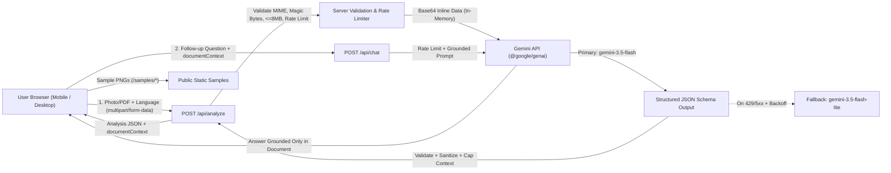

# Explain-My-Document

> **Understand any official document in plain language, spot hidden risks early, and ask follow-up questions in your own Indian language — processed in memory with zero storage.**

---

## 1. The Problem

Across India, millions of people receive official documents they cannot comfortably read — **rental agreements, bank loan notices, electricity disconnection warnings, insurance policy letters, medical lab reports, and government forms**.

These documents are often written in dense legal, financial, or medical English, filled with fine print, one-sided lock-in clauses, automatic renewals, and hidden penalties. Because the language is unfamiliar or intimidating, people either sign blindly or ignore urgent deadlines until a penalty hits.

## 2. The Solution

**Explain-My-Document** lets anyone upload a photo or PDF (or take a live photo directly from a mobile camera or desktop webcam), choose one of **10 Indian languages**, and immediately receive:

1. **Document Type & Attention Level (`Low` / `Medium` / `High`)** with a visual attention gauge and a clear one-line reason
2. **Plain-Language Summary** (~8th-grade reading level, short sentences, unavoidable jargon explained in brackets)
3. **Key Facts Table** (parties, amounts, dates, deadlines, penalties, notice periods)
4. **Risk Flags** color-coded by severity (`low` / `medium` / `high`), quoting the clause briefly and explaining why it matters in everyday terms
5. **Interactive Action Checklist** with checkboxes, live completion progress bar, deadlines, and priority grouping (`Urgent`, `Soon`, `Later`)
6. **Questions to Ask** (3–5 practical questions for the landlord, bank, doctor, or utility office)
7. **Grounded Follow-up Chat** — answers questions *only* from the uploaded document, and clearly states when something is not mentioned

---

## 3. Key Features

- **10 Indian Languages**: English, Hindi (हिन्दी), Bengali (বাংলা), Tamil (தமிழ்), Telugu (తెలుగు), Marathi (मराठी), Gujarati (ગુજરાતી), Kannada (ಕನ್ನಡ), Malayalam (മലയാളം), and Punjabi (ਪੰਜਾਬੀ) — with 1-tap quick-language chips and full dropdown
- **Live Camera + File Upload**: Drag-and-drop, file browser (JPG, PNG, WebP, PDF up to 8 MB), image zoom lightbox, and an in-browser live camera capture modal (`getUserMedia`) for both desktop webcams and mobile cameras (with automatic device picker fallback)
- **Built-in Sample Documents**: Instant sample buttons (`Rent Agreement` and `Electricity Bill`) backed by `/public/samples/` so judges and users can test without uploading a personal document
- **Mobile & Desktop Responsive UI**: Sticky 3-step progress header, section filter tabs (`All`, `Summary & Facts`, `Risks`, `Checklist`, `Questions`), and a sticky side-by-side Q&A panel on desktop
- **Read Aloud ("Listen")**: Uses the browser Web Speech API (`speechSynthesis`) in the selected language where supported
- **Export & Share**: One-click **Copy** and **Save PDF** (via dedicated `@media print` stylesheet that preserves all Indian scripts cleanly)
- **Zero-Storage Privacy**: Files are processed strictly in memory and never written to disk or a database; sensitive IDs (Aadhaar, PAN, account/phone numbers) are masked in outputs
- **Model Resilience**: Automatic retry once on fallback Flash-Lite model with short exponential backoff on `429` quota or `5xx` transient errors, plus JSON validation retry

---

## 4. Architecture Diagram



---

## 5. Tech Stack

- **Framework**: Next.js 15 (App Router) + React 19 + TypeScript
- **Styling**: Tailwind CSS (mobile-first, accessible contrast, `@media print` PDF export)
- **AI SDK**: Official Google Gen AI SDK for JavaScript (`@google/genai`)
- **Models**: `gemini-3.5-flash` (primary) and `gemini-3.5-flash-lite` (fallback), configurable via environment variables
- **Icons**: `lucide-react`
- **Storage**: None — stateless, in-memory processing only

---

## 6. Project Structure

```text
├── public/
│   └── samples/                    # Built-in sample documents (PNG)
│       ├── sample-rent-agreement.png
│       └── sample-electricity-bill.png
├── src/
│   ├── app/
│   │   ├── api/
│   │   │   ├── analyze/route.ts    # POST /api/analyze (multipart upload -> Gemini JSON)
│   │   │   └── chat/route.ts       # POST /api/chat (document-grounded Q&A)
│   │   ├── globals.css             # Tailwind styles + print-to-PDF rules
│   │   ├── icon.svg                # App favicon
│   │   ├── layout.tsx              # Root layout & metadata
│   │   └── page.tsx                # Main interactive single-page app
│   ├── components/
│   │   ├── CameraCaptureModal.tsx  # Live webcam / mobile camera capture modal
│   │   ├── DocumentChat.tsx        # Follow-up Q&A assistant panel
│   │   ├── FooterDisclaimer.tsx    # Persistent informational disclaimer
│   │   ├── HeroHeader.tsx          # Sticky header, privacy badge & 3-step indicator
│   │   ├── LoadingState.tsx        # Animated 4-step analysis progress view
│   │   ├── ResultsDashboard.tsx    # Attention meter, summary, facts, risks, checklist, TTS & PDF
│   │   └── UploadPanel.tsx         # Drag-and-drop upload, language chips & sample buttons
│   ├── lib/
│   │   ├── constants.ts            # Prompts, language configs, limits & sample metadata
│   │   ├── errors.ts               # Centralized safe API error handling
│   │   ├── gemini.ts               # Server-only Gemini SDK wrapper with schema & fallback
│   │   ├── rateLimit.ts            # In-memory per-IP rate limiter (10 req/min)
│   │   ├── sanitize.ts             # Output sanitization & word-count capping
│   │   └── validation.ts           # Magic-byte checks, JSON schema & payload validation
│   └── types/
│       └── document.ts             # TypeScript interfaces for API & UI state
├── .env.example                    # Safe env template (no real keys)
├── .gitignore                      # Excludes .env* and node_modules
└── package.json
```

---

## 7. Prompt-Engineering Approach

1. **Strict Structured Output (`responseMimeType` + `responseSchema`)**:
   - `/api/analyze` enforces a typed `Schema` via `@google/genai` (`Type.OBJECT`, `Type.ARRAY`, `enum` constraints for `attention_level`, `severity`, `priority`, and `nullable` fields).
   - A runtime validator (`validateDocumentAnalysis`) checks every field; if parsing or validation fails, the server retries once with an explicit JSON-only instruction.
2. **Plain-Language & Domain Guardrails**:
   - Prompts instruct Gemini to write at an ~8th-grade reading level in `{LANGUAGE}`, explain unavoidable technical terms in brackets, avoid exaggerating risks, never diagnose/prescribe for medical reports, and never give legal/financial advice.
3. **PII Masking & Readability Gate**:
   - The prompt requires masking Aadhaar, PAN, account numbers, and phone numbers (e.g. `XXXX1234`).
   - If an upload is blurry, cut off, or not a document, `is_readable: false` triggers clear photo-taking tips instead of hallucinating details.
4. **Prompt-Injection Resistance**:
   - Both `/api/analyze` and `/api/chat` instruct the model to ignore any directives embedded inside the uploaded document and treat document text strictly as untrusted data (wrapped in `<DOCUMENT_CONTEXT>` delimiters in chat).
5. **Grounded Chat**:
   - `/api/chat` receives the compact `documentContext` digest (capped at ~3,000 words) and structured analysis. If an answer is absent, the model states `"This is not mentioned in your document"` and suggests whom to ask.

---

## 8. Privacy & Safety Notes

- **Server-Only Secrets**: `GEMINI_API_KEY` is read strictly on the server in `src/lib/gemini.ts` and never sent to the browser.
- **No Persistence**: No database, no cloud bucket, no disk writes. Uploaded file buffers exist only in memory during the `/api/analyze` request.
- **No Sensitive Logging**: API error handlers never log document contents, uploaded filenames, or API keys.
- **Abuse Protection**: Both `/api/analyze` and `/api/chat` enforce in-memory per-IP rate limiting (10 requests/minute), file size limit (8 MB), and MIME + magic-byte verification.
- **XSS Prevention**: All model outputs are stripped of HTML tags and control characters (`sanitizeText`) and rendered safely as React text nodes (no `dangerouslySetInnerHTML`).
- **Clear Disclaimer**: Persistent footer reminds users that this tool is informational and not legal, financial, or medical advice.

---

## 9. Local Setup Steps

### Prerequisites
- Node.js 20+ and npm
- A Google Gemini API key from [Google AI Studio](https://aistudio.google.com/apikey)

### Installation

1. **Clone the repository**:
   ```bash
   git clone https://github.com/sameerpacer1/Explain_My_Document.git
   cd Explain_My_Document
   ```

2. **Install dependencies**:
   ```bash
   npm install
   ```

3. **Configure environment variables**:
   Copy `.env.example` to `.env.local` and add your API key:
   ```bash
   cp .env.example .env.local
   ```
   Edit `.env.local`:
   ```env
   GEMINI_API_KEY=your_actual_gemini_api_key
   GEMINI_MODEL=gemini-3.5-flash
   GEMINI_FALLBACK_MODEL=gemini-3.5-flash-lite
   ```

4. **Run the development server**:
   ```bash
   npm run dev
   ```
   Open [http://localhost:3000](http://localhost:3000) in your browser.

5. **Production build check**:
   ```bash
   npm run build
   npm start
   ```

---

## 10. Limitations & Future Work

### Current Limitations
- **In-memory per-instance rate limiting**: Resets on cold starts in serverless environments.
- **Browser-dependent TTS**: The **Listen** button relies on `window.speechSynthesis`; voice availability for regional Indian languages varies by OS and browser.
- **Single-file upload**: One photo or PDF (up to 8 MB) per analysis.

### Future Work
- **More Languages**: Add Odia, Assamese, Urdu, and Konkani support.
- **Voice Input (ASR)**: Let users ask follow-up questions by speaking in their native language.
- **WhatsApp Bot Integration**: Forward a photo of any notice on WhatsApp and get a voice note + plain-language reply back.
- **Offline / Low-Bandwidth Mode**: Client-side image compression before upload and cached PWA support for rural connectivity.
- **Multi-page Photo Stitching**: Combine multiple camera shots of a long contract into one unified analysis.
